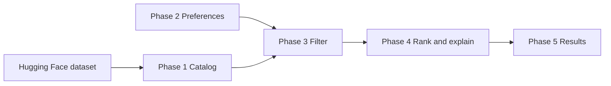
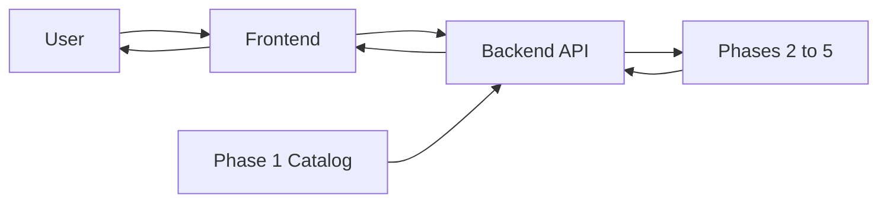
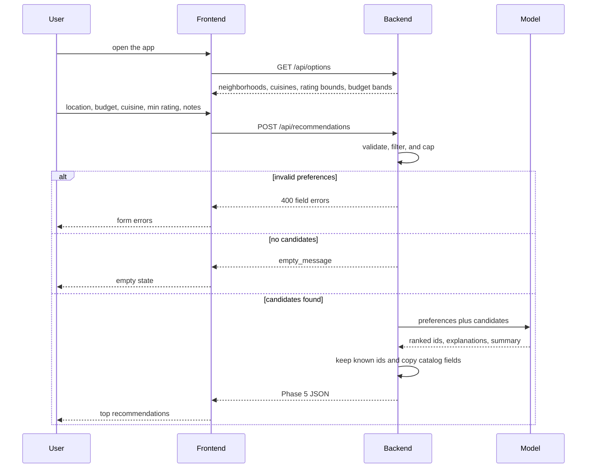

# Phase-wise Architecture

This architecture follows the five steps in [problem statement.md](problem%20statement.md). Each phase has one job and hands a single artifact to the next phase. Filters run before the model, and every restaurant shown to the user comes from the cleaned dataset.

Phases 1–5 are the recommendation pipeline. After Phase 5, the user does not talk to that pipeline directly. A backend API runs it, and a frontend app is the only screen.

The Hugging Face dataset ([ManikaSaini/zomato-restaurant-recommendation](https://huggingface.co/datasets/ManikaSaini/zomato-restaurant-recommendation)) is a Bangalore Zomato dump. `location` is a neighborhood such as Banashankari, not a city such as Delhi. Location choices in the app should come from values that exist in the catalog.

## Flow

The first diagram is the pipeline inside the backend. The second is how the user reaches it.





| Phase | Job | Input | Output |
| --- | --- | --- | --- |
| 1. Catalog | Load and clean the dataset | Hugging Face dump | Queryable restaurant table |
| 2. Preferences | Collect what the user wants | Form or API request | Preference object |
| 3. Filter | Keep only restaurants that fit | Preferences + catalog | Capped candidate list |
| 4. Rank and explain | Order the candidates and say why | Preferences + candidates | Ranked recommendations |
| 5. Results | Show a short, scannable list | Ranked recommendations | Name, cuisine, rating, cost, explanation |
| Backend | Run the pipeline over HTTP | Preference JSON | Phase 5 JSON. No HTML. |
| Frontend | Draw the form and the list | Options and Phase 5 JSON | The screen the user sees |

## Shared data

Later phases use only these shapes. The model does not invent restaurants or overwrite catalog facts.

**Restaurant** — one cleaned row.

| Field | Dataset column | Use |
| --- | --- | --- |
| `id` | Derived from name + address | Stable identity across phases |
| `name` | `name` | Display |
| `location` | `location` | Hard filter |
| `cuisines` | `cuisines` | Hard filter and display |
| `cost_for_two` | `approx_cost(for two people)` | Budget filter and display |
| `rating` | `rate` | Minimum-rating filter and display |
| `votes` | `votes` | Tie-break when capping candidates |
| `rest_type` | `rest_type` | Context for explanations |
| `dish_liked` | `dish_liked` | Context for explanations |
| `online_order` | `online_order` | Context for notes such as quick service |
| `book_table` | `book_table` | Context for notes such as family dining |

Leave `reviews_list` and `menu_item` out of the catalog the model sees. Review text can be very large and is not required to match or explain a restaurant.

**Preferences**

| Field | Rule |
| --- | --- |
| `location` | Required. A neighborhood present in the catalog. |
| `budget` | Required. `low`, `medium`, or `high`. |
| `cuisine` | Required. Matched against the cuisine list. |
| `min_rating` | Required. Rows below this rating are dropped. |
| `notes` | Optional, for example family-friendly or quick service. |

**Recommendation** — one card in the result.

| Field | Where it comes from |
| --- | --- |
| Name, cuisine, rating, cost | The catalog row for that `id` |
| Explanation | The model, for that `id` only |
| Summary | Optional short overview of the whole shortlist |

## Phase 1 — Catalog

Ingest the dataset and store only the fields needed for matching and display.

- Download the dataset once and keep a local copy. Do not call Hugging Face on each user request.
- Parse `rate` values such as `4.1/5` into a float. Drop rows with a missing rating, `NEW`, or `-`.
- Parse `approx_cost(for two people)` into an integer. Some values contain commas.
- Split `cuisines` on commas into a list.
- Keep one row per restaurant. The same place is repeated for different `listed_in(type)` and `listed_in(city)` values. Deduplicate on name + address.
- Turn `low`, `medium`, and `high` into rupee ranges from the cost distribution in this catalog, and store those thresholds with the data.
- Save the cleaned table locally, for example as Parquet or SQLite, and load it when the app starts.

**Done when** a lookup by location, cuisine, minimum rating, and budget returns restaurant rows, and the same restaurant at the same address appears once.

## Phase 2 — Preferences

Collect location, budget, cuisine, minimum rating, and optional notes.

- Accept one request, either from a form or as a JSON body with the Preference fields.
- Fill location and cuisine options from the catalog so the user cannot ask for a place or cuisine that is not in the data.
- Treat notes as optional. A request with empty notes is still valid.
- Validate before filtering: known location, known cuisine, a rating inside the catalog range, and a budget of low, medium, or high.

**Done when** invalid input never reaches the filter, and a valid submission is one Preference object.

## Phase 3 — Filter

Select restaurants with fixed rules. The model reasons over this shortlist, not the full dataset.

1. Keep rows whose location equals the requested neighborhood.
2. Keep rows whose cuisine list contains the requested cuisine.
3. Keep rows whose rating is at least `min_rating`.
4. Keep rows whose cost for two falls in the selected budget band.
5. If no rows remain, stop. Do not call the model.
6. If many rows remain, cap the list before the prompt. Order by rating, then votes, and send about 15–20 candidates.
7. Send only the Restaurant fields. Omit phone, URL, address, reviews, and menu text.

**Done when** every candidate matches location, cuisine, rating, and budget, the list is capped, and an empty match returns no model call.

## Phase 4 — Rank and explain

Prompt the model to rank the candidates, explain why each one fits, and optionally summarize the choices.

- Send the Preference object and the capped candidate list in one prompt.
- Require structured output: an ordered list of `{ id, explanation }` and an optional `summary`.
- When notes are present, the ranking and the explanation must use them. When notes are absent, rank on rating and fit to budget and cuisine.
- After the response, drop any `id` that was not in the candidate list. Copy name, cuisine, rating, and cost from the catalog.
- Return a small set, about 5 restaurants. If fewer ids are valid, show only those.
- If the model times out or returns invalid JSON, show the top candidates by rating with catalog facts and no generated explanation.

**Done when** every suggestion is a candidate from Phase 3, notes change the order or the wording when provided, and displayed facts match the catalog row.

## Phase 5 — Results

Present the top recommendations so they are easy to scan.

- Show the summary once, above the list, when the model returned one.
- For each restaurant show name, cuisine, rating, estimated cost for two, and the explanation.
- When Phase 3 finds nothing, say which filters left no matches.
- When the model fails, show the Phase 4 fallback: catalog facts, no invented explanation.

**Done when** the user sees a few options, each with name, cuisine, rating, cost, and a reason, and never an unfiltered dump of matching restaurants.

## After Phase 5 — Backend and frontend

Phase 5 decides what a result contains. The backend and frontend decide where that result is produced and where it is drawn. The temporary page in `phase2/ui.py` is replaced by this split. Preference checks, the filter, the Groq call, and the result rules stay in `phase2/` through `phase5/`.

### Backend

The backend is a JSON API. It loads the catalog at startup and runs Phases 2–5 for each search. It does not return HTML.

| Method | Path | Body | Response |
| --- | --- | --- | --- |
| `GET` | `/api/options` | None | Neighborhoods, cuisines, rating bounds, and the three budget bands with their rupee limits |
| `POST` | `/api/recommendations` | Preference fields | The Phase 5 list |
| `GET` | `/api/health` | None | Whether the catalog loaded |

`POST /api/recommendations` returns the normalized preferences plus the Phase 5 payload: up to five cards (`id`, `name`, `cuisines`, `rating`, `cost_for_two`, `explanation`), `explanations_available`, `model_called`, and `summary` or `empty_message` when those exist.

- Invalid preferences are `400` with the field errors. The filter and the model do not run.
- An empty filter is `200` with `empty_message` and `model_called: false`. It is not an error status.
- A model timeout, missing key, or unusable reply is `200` with catalog cards and `explanations_available: false`.
- A missing catalog is not a search. `/api/health` reports it, and `/api/recommendations` is refused.
- The Groq key stays on the server. The browser never receives it.
- The API allows the frontend origin only. Phone, URL, address, reviews, and menu text stay out of every response.

**Done when** the same preference body can be sent without a browser and returns the Phase 5 JSON, and no route returns a page.

### Frontend

The frontend is a Next.js app. It draws the form and the Phase 5 list, and it calls only the backend. A paste-ready UI brief for that app is in [stitch-prompt.md](stitch-prompt.md).

- On load, fill location and cuisine from `GET /api/options`. Do not ship a copy of the catalog in the browser.
- Show each budget band with the rupee range from that response, so medium is visibly “more than the low limit and up to the medium limit,” not an exact price.
- Submit location, budget, cuisine, minimum rating, and optional notes to `POST /api/recommendations`.
- Draw the summary once, above the cards, when the payload includes one.
- On each card, show the returned name, every cuisine, the rating, the estimated cost for two, and the explanation.
- When `empty_message` is set, show that text and no cards.
- When `explanations_available` is false and cards are present, show the catalog facts and say that no AI explanation was produced.
- Leave ranking, filtering, and the model key out of the frontend. A card the API did not return is not added on screen.

**Done when** the screen matches Phase 5 for a normal list, an empty filter, and a model fallback, and the frontend still works if it is opened against the API with no HTML served by Python.

## Request path



## Module layout

```text
app/                  shared contracts, config, and errors
phase1/               catalog ingest and load
phase2/               preference validation and catalog options
phase3/               hard filter and candidate cap
phase4/               Groq rank and explain
phase5/               result rules and the JSON list
backend/              JSON API over phases 2–5. No HTML.
frontend/             Next.js form and results screens. No catalog and no model key.
data/
  restaurants.parquet
  budget_thresholds.json
```

Build phases 1–5 first. Phase 3 can be checked with sample preferences before any model key exists. Phase 4 is correct only when every returned id was in the candidate list sent to the model. The backend and frontend come after Phase 5 and do not change those rules.
